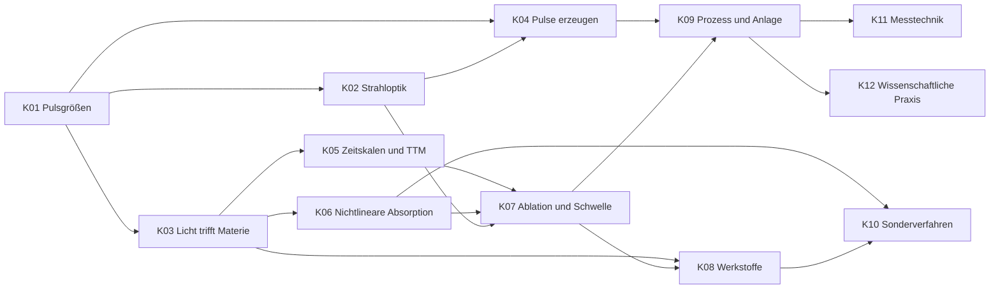

# Lernpfad und Kapitelplan

Stand: Oktober 2026. Dieser Plan ersetzt den ersten Entwurf aus dem ursprünglichen Projektentwurf (dort fehlten Strahloptik und „Licht trifft Materie" als eigene Bausteine, und die Abhängigkeiten waren nicht ausgewiesen). Alle Fachinhalte sind **nicht gegen Primärliteratur geprüft**, siehe Abschnitt „Quellenlage".

## 1. Didaktische Leitlinien

1. **Von Größenordnungen zu Mechanismen.** Erst ein Zahlengefühl (fs, ps, ns; J/cm², W/cm²), dann das Modell. Ohne Gefühl für die Zeitskalen bleibt „nichtthermisch" ein Schlagwort.
2. **Jedes Photonik-Konzept wird hergeleitet oder anschaulich eingeführt.** Vorwissen (Wärmeleitung, Werkstoffkunde, Lasergrundlagen aus PBF-LB/M) wird nicht wiederholt, sondern als Brücke genutzt: „Du kennst das vom Schmelzbad, hier ist der Unterschied".
3. **Lernen durch Abfragen.** Pro Lektion kurze Erklärung, dann sofort Fragen. Fragen und Karten wandern in die Wiederholung (SM-2).
4. **Rechnen statt nur Lesen.** Zahlenfragen mit Toleranz und kleine Rechner (Fluenz, Photonenenergie) machen die Größen greifbar.
5. **Weiches Freischalten.** Kapitel bauen aufeinander auf; die App empfiehlt die Reihenfolge, sperrt aber nie hart. Wer ein Kapitel schon kann, schaltet es per Tippen frei.
6. **Spielerisch, nicht kindisch.** XP, Level, Tagesserie und „gefestigt"-Anzeige; keine Herzen, keine Strafen, kein Zeitdruck.

## 2. Stufen und Kapitel

Ergänzung in Version 0.3: **K00 Werkzeugkasten** (Zehnerpotenzen, Einheiten, Logarithmus, Abschätzen, Taschenrechner) als Start von Stufe A, die Kapitel K08, K10 und K12 sind ausgearbeitet, und die neue **Stufe E** enthält **K13 Wissenschaftliches Englisch**. Jedes Kapitel von K01 bis K11 hat am Ende eine Rechentraining-Lektion.

### Stufe A · Fundament

| Kap. | Titel | Voraussetzung | Lektionen (Entwurf) |
|---|---|---|---|
| K01 | Pulsgrößen und Zahlengefühl | – | Zeitskalen fs bis ns · Energie, Leistung, Spitzenleistung · Fluenz und Intensität · Photonenenergie |
| K02 | Strahloptik: vom Laser zum Fokus | K01 | Gauß-Strahl und Spitzenfluenz · Fokussierung, Rayleighlänge, Spotgröße · Strahlqualität M² · Polarisation und Wellenlänge |
| K03 | Licht trifft Materie | K01 | Bänder: Metall, Halbleiter, Isolator · Absorption, Reflexion, Eindringtiefe · Lineare vs. nichtlineare Absorption · Brückenkapitel: Laser-Metall (PBF-LB/M) vs. Dielektrikum |

### Stufe B · Ultrakurzpulse

| Kap. | Titel | Voraussetzung | Lektionen (Entwurf) |
|---|---|---|---|
| K04 | Ultrakurzpulse erzeugen | K01, K02 | Bandbreite und Pulsdauer · Modenkopplung · Dispersion und Chirp · CPA und Verstärkerarchitekturen · Repetitionsrate, Pulsenergie, Leistung |
| K05 | Zeitskalen und Zwei-Temperatur-Modell | K03 | Wärmediffusion vs. Pulsdauer · Elektronen- und Gittersystem · Zwei-Temperatur-Modell · Warum „kalt" nur relativ ist |
| K06 | Nichtlineare Absorption in Dielektrika | K03 | Mehrphotonenabsorption · Tunnelionisation und Keldysh-Parameter · Avalanche-Ionisation · Plasma und kritische Dichte |

### Stufe C · Abtrag

| Kap. | Titel | Voraussetzung | Lektionen (Entwurf) |
|---|---|---|---|
| K07 | Ablationsmechanismen und Schwelle | K02, K05, K06 | Ablationsschwelle und Abtragtiefe vs. Fluenz · Schwellenbestimmung (D²-Methode) · Mechanismen: Spallation, Phasenexplosion, Coulomb-Explosion · Inkubation · Burst-Mode und Wärmeakkumulation |
| K08 | Werkstoffe: Quarzglas, Keramik, Halbleiter | K03, K07 | Quarzglas · Oxid- und Nichtoxidkeramik · Silizium und Verbindungshalbleiter · Rissbildung und Eigenspannung |

### Stufe D · Prozess und Praxis

| Kap. | Titel | Voraussetzung | Lektionen (Entwurf) |
|---|---|---|---|
| K09 | Prozessparameter und Anlagentechnik | K04, K07 | Pulsabstand und Überlapp · Hatch, Spurabstand, Linienabtrag · Scanner, f-Theta, Fokuslage · Strahlführung, Pulsformung, Burst · DoE für UKP-Prozesse (Brücke zur Masterarbeit) |
| K10 | Sonderverfahren | K06, K08 | LIPSS · Selective Laser Etching · Bessel-Strahl und Filamentation · Wellenleiter und Volumenmodifikation |
| K11 | Messtechnik und Prozessdiagnostik | K09 | Pulsdauer messen (Autokorrelation) · Strahlprofil und Leistung · Oberflächencharakterisierung (ISO 21920) · In-situ-Überwachung |
| K12 | Wissenschaftliche Praxis in der Photonik | K09 | Journals und Konferenzen · Paper lesen und einordnen · Literaturverwaltung · Einordnung der eigenen Arbeit |

Dazu: **Glossar** (durchsuchbar, aus allen Kapiteln verlinkt) und **Wiederholen** (SM-2-Sitzung über alle bisher gesehenen Fragen und Karten).

Stand Version 0.2: **K01 bis K07, K09 und K11 sind ausgearbeitet**; K08, K10 und K12 stehen als Gliederung in `content/index.json` („bald verfügbar"). K08 wartet auf belegte Materialkennwerte aus der Literatur.

## 3. Spielmechanik

| Element | Regel |
|---|---|
| XP | Quizfrage richtig im ersten Versuch: 10 XP, später richtig: 3 XP. Karte bewertet: 5 XP. Lektion abgeschlossen: 20 XP. Wiederholung richtig: 3 XP |
| Level | Level = 1 + ⌊√(XP / 40)⌋, mit Titeln (z. B. „Pulsbeobachter", „Schwellenjäger") |
| Tagesserie | Aufeinanderfolgende Tage mit mindestens einer Antwort; wird aus dem Aktivitätslog berechnet, nicht separat gespeichert |
| Tagesziel | Einstellbar (Standard 40 XP), Fortschrittsring auf der Startseite |
| Gefestigt | Eine Frage gilt als gefestigt, wenn ihr SM-2-Intervall ≥ 21 Tage ist. Kapitel-Meisterschaft = Anteil gefestigter Fragen |
| Freischalten | Kapitel öffnet empfohlen, wenn alle Voraussetzungen zu ≥ 80 % abgeschlossen sind; manuelles Freischalten jederzeit möglich |

## 4. Wiederholungslogik (SM-2) in einfachen Worten

Die App merkt sich für jede Frage und Karte, **wie leicht sie dir fiel**, und fragt sie in wachsenden Abständen wieder: erst nach 1 Tag, dann nach 6 Tagen, danach jeweils nach dem vorherigen Abstand mal einem Leichtigkeitsfaktor (Start 2,5; Untergrenze 1,3). Fällt dir etwas ein, wird der Abstand größer; vergisst du es, fängt die Frage von vorn an. So lernst du wenig Wichtiges selten und Schwieriges oft, und die Wiederholungen bleiben pro Tag überschaubar.

Umsetzung und Entscheidungen: [ADR 0004](adr/0004-sm2-wiederholung.md).

## 5. Quellenlage dieser Recherche

Recherche per Websuche, Oktober 2026. Die Treffer stützen die **Reihenfolge**, nicht die Fachaussagen; Fachaussagen in den Lerninhalten werden separat gekennzeichnet.

- Kursaufbau Ultrakurzpuls-Materialbearbeitung (Laserphysik, Sicherheit, Pulserzeugung, Ablation): [Uni Kassel, Moodle-Kursinfo](https://moodle.uni-kassel.de/course/info.php?id=12892)
- Femtosekunden-Ablation: Grundlagen und Anwendungen (Schwelle, Effizienz, Plume): [core.ac.uk](https://core.ac.uk/works/101132823)
- Ablationsmechanismen nach Fluenz (Spallation, Phasenexplosion): [IntechOpen-Kapitel](https://intechopen.com/chapters/56805)
- Chichkov et al. 1996, *Femtosecond, picosecond and nanosecond laser ablation of solids*, Appl. Phys. A 63, 109–115: [DOI](https://dx.doi.org/10.1007/bf01567637)
- Stuart et al. 1996, *Nanosecond-to-femtosecond laser-induced breakdown in dielectrics*, Phys. Rev. B 53, 1749: [OSTI](https://www.osti.gov/biblio/278537)
- Schaffer, Brodeur, Mazur 2001, *Laser-induced breakdown and damage in bulk transparent materials induced by tightly focused femtosecond laser pulses*, Meas. Sci. Technol. 12, 1784: [Cornell-Publikationsliste](https://snlab.bme.cornell.edu/uploads/publication/2001Schaffer.pdf)
- Sugioka & Cheng 2014, *Ultrafast lasers – reliable tools for advanced materials processing*, Light Sci. Appl. 3, e149: [Eintrag](https://pure.ecnu.edu.cn/en/publications/ultrafast-lasers-reliable-tools-for-advanced-materials-processing/)
- Zwei-Temperatur-Modell, Kopplung und Grenzen: [arXiv 2005.05186](https://arxiv.org/pdf/2005.05186), [arXiv 1911.12414](https://arxiv.org/pdf/1911.12414)
- Ionisationsmechanismen in Dielektrika (Keldysh, Avalanche): [IntechOpen-Kapitel](https://intechopen.com/chapters/52832)
- Lehrbuch Pulsphysik: Diels & Rudolph, *Ultrashort Laser Pulse Phenomena* (Hintergrund zu Erzeugung, Ausbreitung, Messung; Ausgabe 1996 bzw. 2. Aufl.)
- SM-2: [Beschreibung von Wozniak](https://supermemo.guru/wiki/SuperMemo_2), [Anki-FAQ zum Scheduler](https://faqs.ankiweb.net/what-spaced-repetition-algorithm)

**Nicht gefunden:** Logo und Webseite der AG alp (die TH-Seite ließ sich nicht abrufen). Das App-Icon ist daher eine eigene Gestaltung, siehe [offene Punkte](offene-punkte.md).
